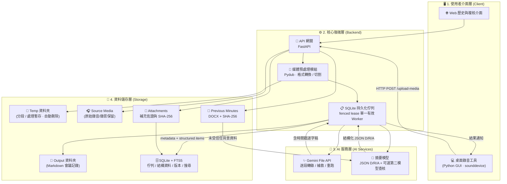
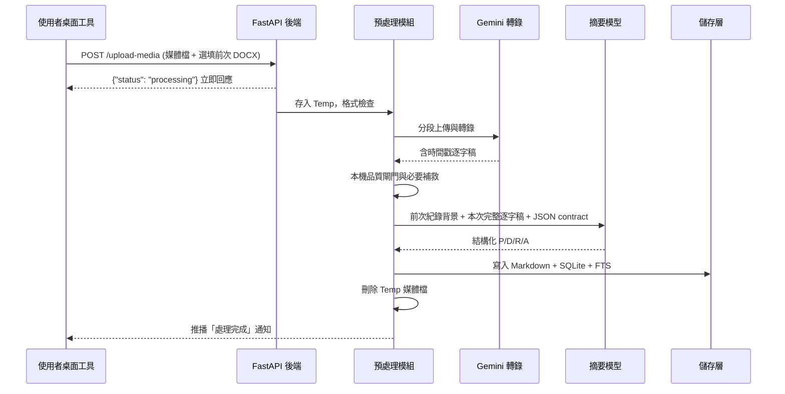

# 🎙️ AI 語音會議助理 — 現行系統架構文件 v2.8

> **文件版本**：2.8.0
> **更新日期**：2026/08/03
> **現況**：FastAPI、SQLite 持久化佇列、Web/GUI、多段轉錄、品質閘門、人工複核與全文搜尋均為現行功能；LINE webhook 與 ngrok 自動 tunnel 已移除。

---

## 一、系統架構圖 (System Layers)



---

## 二、層級說明總覽

| 層級名稱 | 負責模組與技術堆疊 | 主要任務 |
| --- | --- | --- |
| **1. 使用者介面層 (Client)** | Web 歷史與複核介面<br>Python GUI (Tkinter/PyQt) + `sounddevice` | 收集音訊或影片來源；Web 上傳或既有會議詳情可選擇前次會議紀錄 `.docx`，最後展示結果與重產來源供使用者複核。 |
| **2. 核心後端層 (Backend)** | Python + FastAPI<br>SQLite 持久化佇列 + 單一 Worker | 接收媒體檔、驗證、排程、重試、取消、處理品質閘門，並提供審查與維運 API。 |
| **3. AI 服務層 (AI Services)** | Gemini 轉錄模型 + 摘要/查核模型 | 先產生可追溯逐字稿，再以 JSON contract 產生 D/R/A；高品質模式增加第二模型證據查核。 |
| **4. 資料儲存層 (Storage)** | 本地檔案 + SQLite/FTS5 | 保存原始媒體、Markdown、附件、任務事件、結構化 D/R/A、人工審查狀態與修訂歷史。 |

---

## 三、各模組功能詳細拆解

### 1. 使用者介面層 (Client)

針對實體與線上會議，保留 Web 上傳與桌面錄音兩個受控入口。

#### 🌐 實體會議入口 (Web)
- **情境**：使用手機或錄音設備完成錄音後，從受控 Web 介面上傳。
- **功能**：支援音訊與影片檔案，上傳後可在同一介面追蹤任務與複核結果。
- **中斷保護**：瀏覽器錄製每秒保存到該裝置的 IndexedDB；分頁或上傳中斷後列出可恢復項目並重新送出。後端已保留但未連結會議的原始檔可直接重新排入佇列。
- **運作**：loopback 可直接使用；區網來源須透過短效 bootstrap/API session。

#### 💻 線上會議入口 (桌面錄音小工具)
- **情境**：在電腦前開 Google Meet、Teams 或 Zoom。
- **功能**：極簡視窗，只有「錄音 / 停止」按鈕。
- **運作**：透過 `sounddevice` 或 `pyaudio`，**同時擷取系統喇叭（別人說話）與麥克風（自己說話）**，混音存成本地 `.mp3` 後，自動打 API 送給後端。

---

### 2. 核心後端層 (Backend)

> 可跑在筆電上，或部署於免費雲端平台（如 Render / Fly.io）。

| 子模組 | 技術 | 功能 |
|--------|------|------|
| **API 網關** | FastAPI | 開出 `/upload-media`（Web／桌面端上傳；`/upload-audio` 保留相容）、未連結原始檔重新處理及審查、搜尋、匯出與維運端點 |
| **媒體預處理** | Pydub | 必要時抽取/轉換音訊並切割，保留原始音訊或影片作為證據檔 |
| **任務佇列** | SQLite `jobs` + 單一 Worker | 跨服務重啟保留任務，支援 retry/backoff、取消、進度與事件時間線。 |
| **前次紀錄解析** | `python-docx` + ZIP 封裝限制 + SHA-256 | 驗證並擷取操作者上傳的 `.docx`；保留來源血緣，限制文字長度，不接受舊 `.doc`、加密／巨集／異常封裝或無文字文件。 |

---

### 3. AI 服務層 (AI Services)

> **架構亮點**：轉錄與摘要分離。逐字稿先通過時間戳、音訊覆蓋、重複幻覺與快取安全檢查，再交給摘要模型；因此可以單獨重跑問題段或只重整摘要。

| 方案 | 技術 | 優勢 | 限制 |
|------|------|------|------|
| ⭐ **現行方案（已實作）** | Gemini File API + 分段轉錄 + JSON 摘要 | 可分段補救、保留時間證據、獨立重整摘要 | 仍受上游服務可用性與模型品質影響 |
| 備選方案 | OpenAI Whisper → GPT-4o | 逐字稿品質高、語言支援廣 | 需兩次 API、成本較高、Whisper 25MB 限制 |

**Output Prompt 四大區塊**：
1. 📋 會議摘要 (Executive Summary) — 300 字以內
2. ✅ 重要決議 (Key Decisions) — 條列式
3. 📌 待辦事項 (Action Items) — 表格（任務、負責人、期限、優先級）
4. 📝 完整逐字稿 (Verbatim Transcript) — 附講者標記與時間戳記

---

### 4. 資料儲存層 (Storage)

保持輕量，按需擴展：

```
meeting_assistant/
├── temp/                          ← 分段與處理暫存檔（自動刪除）
├── output/
│   ├── source_audio/              ← 已上傳的原始錄音/錄影（處理後保留，沿用舊資料夾名稱）
│   ├── previous_minutes/          ← 操作者上傳的前次會議紀錄 DOCX（檔名與 SHA-256 寫入品質報告）
│   ├── 2026-07-04_Marketing.md   ← 日期命名的會議記錄
│   ├── 2026-07-05_Sync.md
│   └── ...
└── meetings.db                    ← SQLite（可選，歷史搜尋用）
```

既有會議可在產出後補上一份前次 DOCX。後端保留原紀錄，沿用其完整逐字稿建立高品質摘要重產任務；新紀錄的 `quality_report_json.regeneration` 保存來源會議 ID、來源 job ID、逐字稿 SHA-256 與 `regenerated_with_previous_minutes` 關係。DOCX 路徑、檔名與 SHA-256 仍由持久化佇列傳遞，重啟、重試與記錄快照會沿用相同來源。

**SQLite 資料表設計（現行）**：

| 資料表 | 用途 |
|--------|------|
| `meetings` | 保存會議主檔、品質報告、結構化摘要、人工審查狀態與核准內容 SHA-256。 |
| `meeting_items` | 將 D/R/A 逐項保存成 JSON 索引，保留證據時間、逐項複核／核准狀態、複核者與備註。 |
| `meeting_evidence` | 保存補充附件檔名、路徑、SHA-256、分析內容與對應 revision。 |
| `meeting_evidence_items` | 將補充佐證關聯到一或多個 D/R/A 項目；關聯可與文件版本、附件雜湊一併稽核。 |
| `meeting_confirmation_tasks` | schema v6 的人工確認佇列；保存缺少的負責人、期限或時間碼及 resolved/waived 證據。 |
| `meeting_fts` | SQLite FTS5 虛擬表，索引 `title`、`source_audio`、`summary`、`output_path`，支援快速的欄位搜尋。 |
| `meeting_content_fts` | SQLite FTS5 虛擬表，索引每筆會議的完整 Markdown 內容，支援逐字稿搜尋。 |
| `meeting_revisions` | 保存人工修訂摘要或逐字稿前的完整舊版 Markdown，供回溯 AI 原稿與修改歷史。 |
| `jobs` | 持久化媒體處理佇列，保存狀態、payload、attempts、取消旗標與進度欄位。 |
| `job_events` | 任務事件時間線，記錄建立、worker claim、狀態轉換、retry、取消等事件，供維運與 UI 觀察流程。 |
| `job_event_archive` | schema v5 升級前缺少父任務的歷史事件封存；保留原事件而不讓孤兒資料破壞外鍵。 |
| `runtime_leases` | 保存全域 worker 與啟動維護 lease、heartbeat、generation fencing token。 |
| `app_users` | 帳號與角色表；`MEETING_AUTH_ENABLED=0` 時維持既有本機模式，啟用後中央路由政策全面執行最小權限。本機 session 與精確 CIDR 的 LAN session 使用不同帳號，避免長效區網網址取得 admin。 |
| `audit_logs` | 保存 actor、action、resource 與 request metadata；文件與逐項審查變更會建立稽核紀錄。 |
| `app_meta` | 保存資料庫 schema version，供 `/health` 驗證執行版本。 |
| `schema_migrations` | 保存每版 migration 套用時間與資料修復明細；升級前先建立 SQLite online backup。 |

搜尋流程依序合併欄位 FTS、完整內容 FTS 與參數化 `LIKE` 後備搜尋；後備搜尋補足 SQLite `unicode61` 對中文連續字串部分匹配的限制。兩個 FTS 索引在新增、編輯、刪除會議時增量更新，啟動時只對缺漏的既有資料進行一次性補建，搜尋本身維持唯讀。若部署環境的 SQLite 不支援 FTS5，API 仍可使用 `LIKE` 搜尋欄位與完整內容。

Web 歷史頁可從 `/meetings/{id}/source-media` 串流保留的原始錄音或錄影，並把逐字稿時間戳連回播放器；舊的 `/meetings/{id}/source-audio` 仍保留相容。人工修訂分成兩條路徑：`PUT /meetings/{id}/summary` 只改摘要、決議與待辦；`PUT /meetings/{id}/transcript` 只改完整逐字稿。兩者都會先寫入 `meeting_revisions`，再更新 Markdown 與 FTS 索引，並將會議退回 `needs_review`。`PUT /meetings/{id}/review` 明確保存人工複核／核准；核准時記錄目前 Markdown SHA-256，有阻擋交付的品質問題時拒絕核准。

補充佐證經 `POST /meetings/{id}/evidence` 上傳後，Gemini 的同步 SDK 呼叫會放入工作執行緒，避免阻塞 FastAPI event loop。成功時附件、SHA-256、分析內容、D/R/A 關聯、revision 與全文索引一致更新；失敗時尚未入庫的附件會清理。`PUT /meetings/{id}/items/{item_key}/review` 提供逐項複核／核准，逐項狀態會回捲整份文件，但不會自動取代正式文件核准。

`GET /livez` 是不碰依賴的程序探針；`GET /readyz` 檢查 schema v6 與全域 worker lease。`GET /health` 再加入載入 commit、工作區 commit、程式碼指紋、SQLite quick check、ffmpeg/ffprobe、本機與異地備份健康度及 DB／媒體／備份／可用磁碟容量門檻。大型快照驗證以檔案 identity 快取，並以排除 runtime lease/FTS cache 的 durable record-state 指紋判斷能否重用；備份採 7 天且狀態有變更才新增、各保留 4 份，超齡但狀態未變的驗證備份仍為健康。ZIP/SQLite 可讀但 manifest 有缺檔時明確標示復原不完整並降級；手動強制備份與 schema migration 前備份不受週期限制。

### 5. 治理與維運模組邊界

| 模組 | 責任 | 禁止跨越的邊界 |
| --- | --- | --- |
| `backend.auth` | 身分、角色、中央路由權限政策 | 不接受用戶端自報角色 |
| `backend.review_workflow` | 文件與 D/R/A 逐項狀態轉換、回捲規則 | 不處理 HTTP 或畫面 |
| `backend.evidence` | 附件複製、分析與提交 | 未完成資料庫交易前不得留下孤兒附件 |
| `backend.maintenance` | 一致性備份、記錄快照、驗證與安全還原 | 還原不得覆寫非空目錄 |
| `backend.confirmation_queue` / `confirmation_api` | 歷史 D/R/A 回填後的缺漏確認、解決與 UI API | 不猜測負責人、期限或時間碼 |
| `backend.structured_minutes` | 規則式解析既有標準 Markdown D/R/A | 只回填原文存在的欄位 |
| `backend.capacity` | DB、媒體、備份與磁碟容量健康門檻 | 不做自動刪除 |
| `backend.database` | schema、交易與查詢 | 不反向依賴 review domain 或路由授權 |
| `backend.schema_migrations` | 可回滾 schema 升級、FK/CHECK 與孤兒事件封存 | 不反向依賴 API 或 database facade |
| `backend.access_tokens` | 短效 bootstrap 與簽章 session capability | URL/cookie 不保存原始 API key |

營運查詢都有明確上限：任務延遲與錯誤分類最多讀取最近 1,000 筆，API 清單維持分頁上限；若長期工作量超過單機 SQLite／單 worker 的容量，再以觀測到的 p95 與 queue depth 作為升級外部佇列或 PostgreSQL 的依據。

### 6. 議題式會議紀錄閱讀與匯出（2026/10/08）

本次執行邊界為本地系統修改及驗證，不含 commit/push、部署、正式資料回填或重新呼叫 AI。
`backend.minutes_view` 建立唯讀閱讀模型，`static/minutes-reader.js` / `.css` 提供預設議題式整合、議題總覽圖、待辦總覽及原文四種閱讀方式。
`GET /meetings/{id}` 新增可選 `minutes_view`；資料庫、摘要生成 contract、核准雜湊與逐項審查 API 不變。
現存結構化摘要含人工確認欄位時優先使用；沒有結構化快照才以既有 Markdown parser 解析。格式不完整、重複 ID 或自訂中間章節無法安全整合時保留原文，不推測、不遺漏處理。
`GET /meetings/{id}/export/docx?layout=topics|original` 使用同一模型；預設 topics，original 保留原格式。Word 的議題總覽採可列印表格，Web 採互動分支。

UX intent：讀者先按議題看摘要、決議及任務，再透過時間碼查原始媒體；背景與細節降層，待確認／來源複核標記保持可見。模式切換是唯讀操作，不會變更核准狀態。

| 模式 | 來源與目標 | 範圍／安全策略 | 主要下一步 | 審查責任 |
|---|---|---|---|---|
| 議題式整合 | 同一份 D/R/A → 依議題連讀 | 保留條件、負責人、期限及時間證據 | 查佐證或既有逐項審查 | 維持原審查流程 |
| 議題總覽圖 | 同一份 D/R/A → 分支 | R/A 為同層歸屬，不能推論因果或 R→A；收合保留風險 | 點節點、前往議題全文 | 不自動核准 |
| 待辦總覽 | 同一份 A → 跨議題清單 | 每個 A ID 一次；不自動合併、指派或標完成 | 核對負責人與期限 | 不改原任務 |
| 原文／舊格式 | 完整 Markdown → 原文閱讀 | 不變更內容；安全整合失敗時仍可讀 | 閱讀原文或既有摘要編輯 | 不隱藏未解析內容 |

QA／QC gate：`tests/test_minutes_view.py`、`tests/minutes_reader_test.js` 與架構守門；隔離瀏覽器頁使用真實前端，檢查 1440×900、1024×768、390×844 的四模式、節點開關／Escape、時間碼定位、原文及中譯、切換會議清理、無可見錯誤／水平溢出。來源、D/R/A 數量及待確認狀態必須一致。新功能不得硬編碼會議 60 的 ID、疑似重複任務或時間區間。
高優先失效條件：資料遺失、錯誤歸屬、誤標核准、XSS、未解析紀錄被隱藏、播放器定位錯誤或手機浮層裁切；任一失敗退回 RD。Word 結構／內容測試不等於實際 Word 分頁視覺驗證，兩者分別記錄。

本地驗證紀錄（2026/10/08）：最終完整回歸 628 項測試通過（231.813 秒），其中新功能 27 項涵蓋 API 預設／指定 Word layout、錯誤參數、匯出範本與逐字稿／中譯保留、人工欄位確認、未歸屬／共用項目、格式回退及注入字串。架構與安全掃描通過；沒有新增大型檔案超額。
隔離 UI 以會議 60 的唯讀快照（5 D／4 R／5 A）、合成舊格式紀錄及靜音測試 WAV 驗證 3 尺寸 × 4 模式：無水平溢出、無可見錯誤及 console warning/error；節點／Escape 焦點、時間碼 13:20、品質分段 11:52、切換會議清理、14 項原審查入口均通過。切換原文會移除隱藏逐字稿 DOM，避免時間碼定位到隱藏副本。
證據位於本機 ignored `output/previews/meeting-60/system-qa.json`、同目錄截圖及 `output/minutes-reader-ci-final.log`。隔離 UI 不代表已驗證正式部署、權限或背景工作。Word 已驗證結構與內容；因缺少 bundled 文件渲染器，實際 Word 分頁視覺仍未驗證。本次未 commit/push、未部署、未回填正式紀錄。

### 7. 發言人辨識的目前能力與缺口（2026/10/12）

使用者確認只需區分不同發言人（A／B／C），不要求推測姓名。目前由 Gemini 逐段聽音轉錄並輸出標籤；跨段只傳先前標籤及重疊交界時間，沒有獨立對整場錄音做聲音特徵分群的模型。此為目前可驗證的架構邊界，不代表 Gemini 不具備說話者分離能力，也不代表標籤數等於真實人數。
唯讀檢查會議 60 發現：原品質報告只有「發言者 A」，原逐字稿同時含 A 與未加粗體的 B。`backend.transcript_diagnostics.transcript_speaker_labels` 統一解析時間戳或行首的明確標籤（支援粗體、單星號、純文字與行內時間戳），不計入正文引用或翻譯附錄、不替缺漏段落推測發言人，也不把不明／多人重疊當成額外一人。生成與重新檢核共用此解析；詳情 API 從原逐字稿重新計算顯示值，無資料回填或 AI 呼叫。原逐字稿不變。
本輪是標籤漏算修正與方法評估；聲音層級的改善須以人工標註多發言人片段，比對切換點、錯誤合併及同人錯誤拆分後，再選定專用說話者分離模型。參考 [AssemblyAI 聲音特徵分群說明](https://www.assemblyai.com/docs/faq/how-are-individual-speakers-identified-and-how-does-the-speaker-label-feature-work)、[pyannote.audio](https://github.com/pyannote/pyannote-audio) 與 [Gemini 音訊結構化輸出](https://ai.google.dev/gemini-api/docs/audio)。名詞辨識需分開評估詞彙提示；最近 6 筆的 recording.custom_vocabulary 為空，不可據此認定所有誤字的成因或自行加入未確認同音詞。
QA gate：粗體／純文字／行內混合標籤、未知與多人重疊、正文引用、缺漏不推測、既有 turn parser 相容、品質報告及 API 的唯讀計算由 `tests/test_speaker_labels.py` 驗證。此變更不增加轉錄請求、不自動重跑、不部署。
QC 結果：完整回歸 636 項通過（262.923 秒），架構守門、安全掃描及 diff whitespace 通過。真實會議 60 的唯讀投影由 `[發言者 A]` 修正為 `[發言者 A, 發言者 B]`；此證據驗證標籤解析，不代表已對原音訊進行聲音分群準確度驗證。測試 log 為本機 ignored `output/speaker-label-ci-20261012.log`。工作樹保留既有未提交修改，本輪新增 `tests/test_speaker_labels.py` 並修改 diagnostics、tasks、main 與本文件；尚未 commit/push／部署。

### 7a. 免費語音模型與額度接續契約（2026/10/12）

Human Confirmed：使用者同意接入免費模型，要求額度不足時切換模型接續，不能只因用完額度而失敗。Scope 為本機程式與設定、測試、既有 Google 音訊端點的小片段驗證；不啟用付費模型、不重寫正式紀錄、不自動重跑正式任務或部署。真正的品質、安全上限、無進展、來源缺檔及憑證錯誤仍需有界重試／人工處理；此規則不代表可保證供應商最終恢復。

RD contract：`transcribe_adapter` 透過官方 Interactions REST API 使用 `gemini-3.5-transcribe` verbatim + speaker + word timestamps；不混入不相容的 custom_vocabulary。Google 音檔 upload/delete 仍由既有 SDK 管理。原英文、數字與語氣保留；中文只做本機字形轉繁體，不以雲端重寫名詞。解析使用實測 UTF-8 byte offsets 與 `spk:0`（也相容文件 `spk_1`），缺少／無效註記不假造時間或發言者，而走備援。首次 Transcribe 切段上限 5 分鐘；沿用既有指定切點時，超出保守 TPM 的片段改用 Flash。

`model_routing` 限定自動候選為 Transcribe、3.8 Flash、3.5 Flash、3.5 Flash Lite、3.1 Flash Lite；文字階段加 Gemma 4 31B，排除 Transcribe，音訊排除 Gemma。先用指定主模型／指定備援，再用候選池，記錄實際回應模型並沿用模型隔離快取。舊佇列保留既有 model payload，仍可進入免費候選池，不自行改寫歷史 model 選擇。

`model_availability` 以專案 ID 與模型為 key，在 SQLite 保存原子保守請求預留、冷卻時間與每日計數，跨 worker／重啟共用；不保存 API key，不從計數宣稱已用掉實際 500 次額度。以本次 AI Studio Free tier 實測限額作為預防性節流：Transcribe 3 RPM／10K TPM／25 RPD，Flash 5／250K／20，Lite 15／250K／500，Gemma 30／16K／14,400；估算輸入 token 用於節流，不是帳單。SDK 自動重試設為一次，避免一次排程隱含多次請求；每輪每模型最多呼叫一次。429 按 quota ID 分每日或分鐘冷卻，跳過冷卻模型；全部受限以 `MODEL_QUOTA_WAIT` 返回 pending，保留 progress，不耗失敗次數、不因等待次數轉 failed，仍可取消。額度恢復時間只作排程估計，不宣稱即時剩餘量。 若候選模型回傳 model-not-found／unsupported，使用獨立 capability namespace 冷卻 15 分鐘，跳過後接續其他可用模型；全部設定錯誤不假裝成額度等待。

`job_checkpoints` 保存同一 job／來源 SHA／輸入與設定下成功且已驗證的摘要、結構修復及逐批翻譯，具 checksum 與原子 replace。額度續跑可讀取 job-local 已驗證分段 journal（含混用模型但整段已通過品質的內容），重新通過音訊品質檢查後沿用；混合 journal 不會誤寫為任何單一模型的 shared cache。完整重跑的新 job 不讀舊 shared cache，但該 job 因額度中斷後可沿用自身成功分段。文字來源或設定改變即不匹配。原始音訊在額度等待時不得清除；worker 已失去 ownership 時不得改寫後繼 worker 的狀態。只在完整逐字稿與品質閘門通過後產生正式 meeting；waiting 不假造 done。

發言者邊界：專用模型的匿名 ID 是 request-local，跨片段沒有整場聲紋匹配。來源片段的 SHA-256 短指紋也區分同一父段的不同補救 request，避免 request-local ID 錯誤合併。多段輸出標為「發言者 A（片段 n-音訊指紋）」並加入品質警示，避免誤把不同片段的 A 合併或把標籤數當成人數。3 人以上仍屬供應商實驗性能力，名詞也可能錯認；本輪不宣稱達成整場聲紋辨識準確度。整場 diarization／Live Transcribe 為 future phase，須有人工標註聲音切換與同人合併證據後才重入。

QA gate：多模型連續 429 後成功、全部冷卻零呼叫／零補救 budget、每日等待超過既有 3 次仍 pending、分鐘等待退款、跨程序／專案隔離、原子預留、DST 重置、超大 TPM 改用 Flash、失敗不保存 checkpoint、來源變更失效、完整重跑不讀其他 job 快取、取消與 worker fencing、逐批翻譯續跑、英語與繁體字形／UTF-8 時間註記、既有全回歸、架構與安全守門。供應商憑證／schema 錯誤或無品質進展是停止條件，不以額度等待掩蓋。

QC：本機模型接續與資料保留 gate 通過。最終完整回歸 666 項通過（133.966 秒），模型／額度專項 39 項通過；架構守門、安全掃描及 diff whitespace 通過。實際 queue/task/SQLite（假供應商）驗證多模型 429 → pending（0 次失敗、保留第一段）→ 重啟／恢復後只處理剩餘段 → 正式輸出；另驗證單段混合 journal 的摘要續跑沒有 AI 重轉、沒有錯標 provider shared cache。鎖定 SDK 2.10.0 的 timeout/retry 與 client 相容檢查通過，不全面升級 SDK；只新增帶 hash 的 OpenCC 0.1.7 與直接 httpx 依賴。20 秒既有錄音執行 2 次受控 Transcribe API 呼叫，取得 completed／word_info／spk:0；依真實回應修正代碼、UTF-8 byte offsets 並在本機驗證繁體字形與原文空格。這不是名詞／多人辨識準確度 benchmark，來源與正式紀錄未改，上傳檔已 finally 刪除。證據為 ignored `output/model-continuation-ci-verified-20261012.log`、`output/model-continuation-targeted-20261012.log` 與 `output/transcribe-probe-response-20261012.json`。本輪邊界：新增 model_availability、model_routing、transcribe_adapter、job_checkpoints 與 test_model_continuation；修改 tasks、database、job_queue、transcript_translation、依賴／CI 測試隔離、環境設定及說明文件，保留其他既有 dirty 修改。尚未 commit/push／部署／重啟／正式任務重跑；唯讀 GET /config 確認執行中服務仍使用 gemini-3.1-flash-lite。

參考：[Google Transcribe](https://ai.google.dev/gemini-api/docs/transcribe)、[Google rate limits](https://ai.google.dev/gemini-api/docs/rate-limits)、[Google pricing](https://ai.google.dev/gemini-api/docs/pricing)、[OpenCC Python](https://github.com/yichen0831/opencc-python)。

### 7b. 批次發版邊界（2026/10/13）

Human Confirmed：使用者要求 commit／push／部署。本次將先前已同意的議題式閱讀、dashboard 非阻塞更新、轉錄品質／發言者標籤修正與免費模型額度接續一起提交至既有 `feat/transcript-chinese-translation` 分支，部署至本機既有 port 8001 服務；不推進 main、不新增 PR、不啟用付費額度、不重跑或回填正式會議。排隊／處理中任務須為零才重啟。

發版 gate：2026/10/13 初次完整回歸 666 項通過（158.088 秒）；加入下列備份修正並按鎖定依賴安裝後，最終 670 項通過（221.214 秒）。Python compile、前端 JS 語法／閱讀器／dashboard 測試、架構守門、安全掃描、runtime pip check、鎖定依賴 pip-audit（無已知弱點）與 diff whitespace 通過。既有三尺寸 × 四閱讀模式 UI 證據可重用；另須在重啟後的正式頁驗證清單、會議 60 的四模式與可見錯誤，並核對 readiness、worker lease、runtime commit／source fingerprint、模型設定及資料筆數。feature branch push 不會觸發僅限 main／PR 的 GitHub CI，不將本機測試誤稱為遠端 CI 結果。

發版前的備份檢查發現 6 份 Markdown 的 DB 路徑仍指向舊使用者目錄，但相同檔名檔案存在目前輸出目錄。快照新增明確 `markdown_dir` fallback：原路徑存在時優先使用；不存在才在已設定輸出目錄依檔名查找，不掃描任意目錄、不改 DB／Markdown。startup 與手動備份入口都傳入 `MEETING_OUTPUT_DIR`；4 項回歸涵蓋搬移、原路徑優先、找不到保持 degraded、空路徑不猜測。另按供應商安全修正版只更新 AnyIO 4.14.2、cryptography 50.0.0、urllib3 2.8.0 的 lock／安全下限，維持 Google SDK 2.10.0 及其餘既有鎖定版本；runtime 與 lock 一致。

中風險 release：沿用 schema v6，新增額度表為衍生排程狀態；啟動維護沿用既有保留政策。部署前建立 SQLite、完整來源媒體／會議檔與已設定異地副本並驗證可恢復性，不刪除舊備份。rollback 基準為 `31c39f046372d6e9ea34a57eedf6dbf5efc886de`，保留該 commit 的 source archive 及本機候選環境設定副本；如 smoke 失敗，先停止接收新任務並回復程式／模型設定，不自行覆蓋正式資料庫。密鑰、錄音、正式紀錄、備份與 private QA 截圖不入 Git，`tmp/` 加入忽略規則。

本節記錄發版準備而非預先宣告部署成功。本機 ignored 證據：`output/release-ci-final-20261013.log`、`output/release-audit-fixed-20261013.json`、`output/release-backup-20261013.json`；commit／push／實際部署與 smoke 結果記錄於 `output/release-report-20261013.json`，以執行後事實為準。全場聲紋對應及名詞準確度 benchmark 仍不在此 release 的已驗證能力內。

### 8. P0～P3 驗收矩陣（2026/07/30）

| 優先級 | 驗收範圍 | 完成證據 |
| --- | --- | --- |
| **P0** | 資料完整性、任務血緣、備份一致性、權限邊界 | schema v6 FK/CHECK、原子 meeting/job commit、generation fencing、本機/API session RBAC、全 mutation audit |
| **P1** | 結構化逐項審查與佐證鏈 | 28 筆歷史 D/R/A 回填、逐項 API/UI、`meeting_confirmation_tasks`、`meeting_evidence_items` |
| **P2** | 可觀測性與還原能力 | live/readiness 分離、queue/attempt/lease 指標；本機＋異地 v2 快照、缺檔降級語意、可執行 runtime 還原 |
| **P3** | 維護邊界與容量限制 | review/database 循環移除、全 backend cycle guard、函式／行數守門、容量門檻、bounded restart、依賴弱點掃描 |

---

## 四、標準資料流向 (Data Flow)

以**一次線上會議**的完整流程為例：



---

## 五、開發里程碑 (Roadmap)

| 階段 | 功能 | 狀態 |
|------|------|------|
| **Phase 0** | 單檔處理 CLI 腳本（MVP） | ✅ **已完成並驗證** |
| **Phase 1** | FastAPI 後端 + `/upload-media` 端點（`/upload-audio` 相容舊整合） | ✅ **已完成** |
| **Phase 2** | 桌面錄音 GUI（sounddevice + Tkinter） | ✅ **已完成** |
| **Phase 3** | LINE Bot Webhook 整合 | 🗑️ **已移除（v2.5）** |
| **Phase 4** | SQLite 歷史記錄 + 搜尋功能 | ✅ **已完成** |
| **Phase 5** | 雲端部署（Render / Fly.io） | 🔲 待開發 |

---

## 六、技術選型清單

| 類別 | 套件 / 服務 | 用途 |
|------|------------|------|
| AI 核心 | `google-genai` | Gemini 3.1 Flash-Lite API |
| Web 後端 | `fastapi` + `uvicorn` | API 伺服器 |
| 音訊擷取 | `sounddevice` / `pyaudio` | 麥克風 / 系統聲音擷取 |
| 音訊格式 | `pydub` + `ffmpeg` | 格式轉換、切割 |
| GUI | `tkinter` / `PyQt6` | 桌面錄音視窗 |
| 資料庫 | `sqlite3`（標準庫，免安裝） | 會議記錄元資料 |
| 環境管理 | `python-dotenv` | API Key 管理 |

---

*AI 語音會議助理 · 系統架構文件 v2.6 · 2026/07/30*
